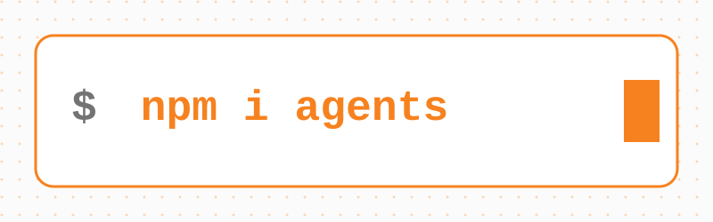

# Cloudflare Agents

[](https://www.npmjs.com/package/agents)
[](https://www.npmjs.com/package/agents)



Agents are persistent, stateful execution environments for agentic workloads, powered by Cloudflare [Durable Objects](https://developers.cloudflare.com/durable-objects/). Each agent has its own state, storage, and lifecycle — with built-in support for real-time communication, scheduling, AI model calls, MCP, workflows, and more.

Agents hibernate when idle and wake on demand. You can run millions of them — one per user, per session, per game room — each costs nothing when inactive.

```sh
npm create cloudflare@latest -- --template cloudflare/agents-starter
```

Or add to an existing project:

```sh
npm install agents
```

**[Read the docs](https://developers.cloudflare.com/agents/)** — getting started, API reference, guides, and more.

> **Building an AI agent?** Use the Pi harness. It runs a model loop with tools inside a Durable Object and recovers from evictions mid-run. See [Build an AI agent with the Pi harness](#build-an-ai-agent-with-the-pi-harness) below.

## Quick Example

A counter agent with persistent state, callable methods, and real-time sync to a React frontend:

```typescript
// server.ts
import { Agent, routeAgentRequest, callable } from "agents";

export type CounterState = { count: number };

export class CounterAgent extends Agent<Env, CounterState> {
  initialState = { count: 0 };

  @callable()
  increment() {
    this.setState({ count: this.state.count + 1 });
    return this.state.count;
  }

  @callable()
  decrement() {
    this.setState({ count: this.state.count - 1 });
    return this.state.count;
  }
}

export default {
  async fetch(request: Request, env: Env, ctx: ExecutionContext) {
    return (
      (await routeAgentRequest(request, env)) ??
      new Response("Not found", { status: 404 })
    );
  }
};
```

```tsx
// client.tsx
import { useAgent } from "agents/react";
import { useState } from "react";
import type { CounterAgent, CounterState } from "./server";

function Counter() {
  const [count, setCount] = useState(0);

  const agent = useAgent<CounterAgent, CounterState>({
    agent: "CounterAgent",
    onStateUpdate: (state) => setCount(state.count)
  });

  return (
    <div>
      <span>{count}</span>
      <button onClick={() => agent.stub.increment()}>+</button>
      <button onClick={() => agent.stub.decrement()}>-</button>
    </div>
  );
}
```

State changes sync to all connected clients automatically. Call methods like they're local functions.

The agent is a Durable Object, so it needs a binding and a SQLite migration in `wrangler.jsonc`:

```jsonc
{
  "name": "counter",
  "main": "server.ts",
  "compatibility_date": "2026-06-11",
  "compatibility_flags": ["nodejs_compat"],
  "durable_objects": {
    "bindings": [{ "name": "CounterAgent", "class_name": "CounterAgent" }]
  },
  "migrations": [{ "tag": "v1", "new_sqlite_classes": ["CounterAgent"] }]
}
```

## Build an AI agent with the Pi harness

If your agent runs a model loop with tools, use [`PiHarness`](https://developers.cloudflare.com/agents/harnesses/pi/). It runs [pi-durable](https://github.com/earendil-works/pi/tree/main/packages/durable) inside a Durable Object. Pi keeps the transcript, tool calls, retries and recovery in the object's SQLite database, and the Agents SDK wakes it after an eviction, so a run continues where it stopped.

```sh
npm install agents @earendil-works/pi-durable @earendil-works/pi-ai @earendil-works/chord
```

```typescript
// server.ts
import { DurableObject } from "cloudflare:workers";
import { createModels } from "@earendil-works/pi-ai/models";
import { createRegistry, Harness } from "@earendil-works/pi-durable";
import { PiHarness } from "agents/harness/pi";
import { Lifecycle } from "agents/lifecycle";
import { createAI } from "agents/models/pi-ai";

export class Assistant extends DurableObject<Env> {
  ai = createAI({ binding: this.env.AI });
  registry = createRegistry();

  harness = new PiHarness({
    harness: ({ storage, context, onWake }) => {
      const models = createModels();
      models.setProvider(this.ai.provider);
      return Harness.open(
        storage,
        { models, registry: this.registry, onWake },
        context
      );
    },
    defaults: { model: this.ai("@cf/zai-org/glm-5.3-flash") }
  });

  lifecycle = Lifecycle.install(this).use(this.harness);

  async ask(prompt: string) {
    return (await this.harness.prompt(prompt)).text;
  }
}

export default {
  async fetch(request: Request, env: Env) {
    const assistant = env.Assistant.getByName("default");
    return new Response(await assistant.ask(await request.text()));
  }
} satisfies ExportedHandler<Env>;
```

```jsonc
// wrangler.jsonc
{
  "name": "assistant",
  "main": "server.ts",
  "compatibility_date": "2026-06-11",
  "compatibility_flags": ["nodejs_compat"],
  "ai": { "binding": "AI" },
  "durable_objects": {
    "bindings": [{ "name": "Assistant", "class_name": "Assistant" }]
  },
  "migrations": [{ "tag": "v1", "new_sqlite_classes": ["Assistant"] }]
}
```

Next steps:

- [Pi harness docs](https://developers.cloudflare.com/agents/harnesses/pi/) — sessions, steering, recovery, and skills
- [Extensions](https://developers.cloudflare.com/agents/harnesses/pi/extensions/) — give the model tools and system prompt sections
- [Pi harness example](examples/next/harnesses/pi) — a complete app that streams sessions over WebSockets, with a filesystem and code execution from [`@cloudflare/computer`](https://github.com/cloudflare/computer)

## Features

| Feature                 | Description                                                                     |
| ----------------------- | ------------------------------------------------------------------------------- |
| **Pi harness**          | A durable model loop with tools, steering, and recovery from evictions          |
| **Persistent State**    | Syncs to all connected clients, survives restarts                               |
| **Callable Methods**    | Type-safe RPC via the `@callable()` decorator                                   |
| **Sub-agents**          | Parent/child DO composition via facets, nested routing, and typed parent lookup |
| **Agent Tools**         | Run chat-capable sub-agents as tools with streaming child timelines             |
| **Scheduling**          | One-time, recurring, and cron-based tasks                                       |
| **WebSockets**          | Real-time bidirectional communication with lifecycle hooks                      |
| **AI Chat**             | Message persistence, resumable streaming, server/client tool execution          |
| **MCP**                 | Act as MCP servers or connect as MCP clients (HTTP, SSE, RPC, elicitation)      |
| **WebMCP**              | Expose page-local tools or bridge remote MCP tools to browser agents            |
| **Workflows**           | Durable multi-step tasks with human-in-the-loop approval                        |
| **Email**               | Send, receive, and reply via Cloudflare Email Service                           |
| **Voice**               | Continuous STT, streaming TTS, VAD, interruption, SFU utilities                 |
| **Browser Agents**      | Run agents in the browser tab with `agents/browser`                             |
| **Code Mode**           | LLMs generate executable TypeScript instead of individual tool calls            |
| **Sandboxed Execution** | Run generated code inside an isolated Worker with a virtual filesystem          |
| **x402 Payments**       | Pay-per-call APIs and tools via the x402 protocol                               |
| **Observability**       | Built-in tracing, metrics, and structured logs                                  |
| **SQL**                 | Direct SQLite queries via Durable Objects                                       |
| **React Hooks**         | `useAgent`, `useAgentChat`, `useVoiceAgent` for frontend integration            |
| **Vanilla JS Client**   | `AgentClient` and `VoiceClient` for non-React environments                      |

## Packages

| Package                                                 | Description                                                                                  |
| ------------------------------------------------------- | -------------------------------------------------------------------------------------------- |
| [`agents`](packages/agents)                             | Core SDK — Pi harness, Agents, routing, Voice, Channels, scheduling, MCP, workflows, x402    |
| [`@cloudflare/ai-chat`](packages/ai-chat)               | Higher-level AI chat — persistent messages, resumable streaming, tool execution              |
| [`@cloudflare/think`](packages/think)                   | Opinionated chat agent base — agentic loop, stream resumption, client tools, workspace tools |
| [`@cloudflare/codemode`](packages/codemode)             | LLMs write executable code that calls your tools, instead of one tool call at a time         |
| [`@cloudflare/worker-bundler`](packages/worker-bundler) | Build and bundle Workers at runtime, for use with the Worker Loader binding                  |
| [`hono-agents`](packages/hono-agents)                   | Hono middleware for adding agents to Hono apps                                               |

## Examples

The [`examples/`](examples) directory has 30+ self-contained demos. A non-exhaustive tour:

- **Pi harness** — [`next/harnesses/pi/`](examples/next/harnesses/pi) runs a Pi agent in a Durable Object, with a browser UI, a filesystem, and code execution
- **Chat & assistants** — [`assistant/`](examples/assistant), [`agents-as-tools/`](examples/agents-as-tools), [`agent-skills/`](examples/agent-skills), [`workspace-chat/`](examples/workspace-chat), [`resumable-stream-chat/`](examples/resumable-stream-chat), [`structured-input/`](examples/structured-input), [`dynamic-tools/`](examples/dynamic-tools), [`multi-ai-chat/`](examples/multi-ai-chat), [`context-overflow-recovery/`](examples/context-overflow-recovery)
- **MCP** — [`mcp/`](examples/mcp), [`mcp-client/`](examples/mcp-client), [`mcp-server/`](examples/mcp-server), [`mcp-worker/`](examples/mcp-worker), [`mcp-worker-authenticated/`](examples/mcp-worker-authenticated), [`mcp-elicitation-mrtr/`](examples/mcp-elicitation-mrtr), [`mcp-elicitation/`](examples/mcp-elicitation), [`mcp-rpc-transport/`](examples/mcp-rpc-transport), [`webmcp/`](examples/webmcp), [`webmcp-react/`](examples/webmcp-react)
- **Code Mode & sandboxes** — [`codemode/`](examples/codemode), [`codemode-mcp/`](examples/codemode-mcp), [`codemode-mcp-openapi/`](examples/codemode-mcp-openapi), [`dynamic-workers/`](examples/dynamic-workers), [`dynamic-workers-playground/`](examples/dynamic-workers-playground), [`worker-bundler-playground/`](examples/worker-bundler-playground)
- **Voice** — [`voice-agent/`](examples/voice-agent) is the unified voice pipeline example with Workers AI, AssemblyAI, Telnyx, and ElevenLabs STT; [`voice-input/`](examples/voice-input) covers dictation; [`telnyx-voice-agent/`](examples/telnyx-voice-agent) covers phone transport; [`elevenlabs-starter/`](examples/elevenlabs-starter) covers broader ElevenLabs media APIs
- **Workflows & approvals** — [`workflows/`](examples/workflows), [`a2a/`](examples/a2a)
- **Auth, payments, comms** — [`auth-agent/`](examples/auth-agent), [`cross-domain/`](examples/cross-domain), [`x402/`](examples/x402), [`x402-mcp/`](examples/x402-mcp), [`email-agent/`](examples/email-agent), [`github-webhook/`](examples/github-webhook), [`push-notifications/`](examples/push-notifications)
- **Game & misc** — [`tictactoe/`](examples/tictactoe), [`ai-chat/`](examples/ai-chat), and [`playground/`](examples/playground), a kitchen-sink app that shows many SDK features in one UI

Examples using the [OpenAI Agents SDK](https://openai.github.io/openai-agents-js/) live in [`openai-sdk/`](openai-sdk). Work-in-progress experiments live in [`experimental/`](experimental) (no stability guarantees).

Run any example locally:

```sh
cd examples/playground
npm start
```

## Documentation

- [Full docs](https://developers.cloudflare.com/agents/) on developers.cloudflare.com
- [`docs/`](docs) directory in this repo (synced upstream)
- [Anthropic Patterns guide](guides/anthropic-patterns) — sequential, routing, parallel, orchestrator, evaluator
- [Human-in-the-Loop guide](guides/human-in-the-loop) — approval workflows with pause/resume
- [`design/`](design) — architecture and design decision records (chat API, sub-agents, agent tools, workspace, voice, browser tools, retries, and more)

## Repository Structure

| Directory                                             | Description                                              |
| ----------------------------------------------------- | -------------------------------------------------------- |
| [`packages/agents/`](packages/agents)                 | Core SDK                                                 |
| [`packages/ai-chat/`](packages/ai-chat)               | AI chat layer                                            |
| [`packages/think/`](packages/think)                   | Opinionated chat agent base                              |
| [`packages/codemode/`](packages/codemode)             | Code Mode                                                |
| [`packages/worker-bundler/`](packages/worker-bundler) | Runtime Workers bundler                                  |
| [`packages/hono-agents/`](packages/hono-agents)       | Hono integration                                         |
| [`examples/`](examples)                               | Self-contained demo apps                                 |
| [`experimental/`](experimental)                       | Work-in-progress experiments (not published)             |
| [`openai-sdk/`](openai-sdk)                           | Examples using the OpenAI Agents SDK                     |
| [`guides/`](guides)                                   | In-depth pattern tutorials                               |
| [`docs/`](docs)                                       | Markdown docs synced to developers.cloudflare.com        |
| [`site/`](site)                                       | Deployed websites (agents.cloudflare.com, AI playground) |
| [`design/`](design)                                   | Architecture and design decision records                 |
| [`scripts/`](scripts)                                 | Repo-wide tooling                                        |

## Development

Node 24+ required. pnpm workspaces with [Nx](https://nx.dev) for task orchestration, caching, and affected detection.

```sh
pnpm install                 # install all workspaces
pnpm run build               # build all packages (Nx, cached, dependency-ordered)
pnpm run check               # sherif + export checks + oxfmt + oxlint + typecheck
pnpm run test                # vitest + vitest-pool-workers (Workers runtime)
pnpm run test:react          # Playwright-based React hook tests
pnpm exec nx affected -t build # build only what changed
pnpm exec nx affected -t test  # test only what changed
```

Changes to `packages/` need a changeset:

```sh
pnpm exec changeset
```

See [`AGENTS.md`](AGENTS.md) for deeper contributor guidance.

## Contributing

We are not accepting external pull requests at this time — the SDK is evolving quickly and we want to keep the surface area manageable. That said, we'd love to hear from you:

- **Bug reports & feature requests** — [open an issue](https://github.com/cloudflare/agents/issues)
- **Questions & ideas** — [start a discussion](https://github.com/cloudflare/agents/discussions)

## License

[MIT](LICENSE)
